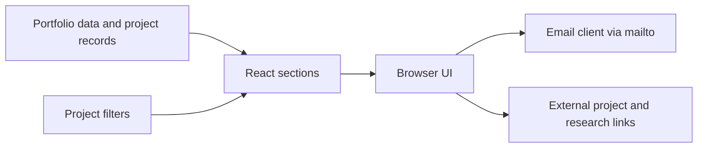

# Ramadan Mohamed Hassan — AI Engineering Portfolio

A responsive portfolio website presenting AI engineering experience, technical skills, 21 project records, research publications, education, awards and contact information. It enables recruiters and engineering collaborators to discover relevant work through category filters, search, project details, and publication links.

**Portfolio:** [ramadan-ai-portfolio.vercel.app](https://ramadan-ai-portfolio.vercel.app/)

## Features

- Animated React interface with reduced-motion support through Framer Motion.
- Searchable project catalogue with overlapping technical categories and project details.
- Research and publication links, downloadable CV and profile image.
- Contact form that opens a prefilled email draft using `mailto:`; it does not send or store messages.

## Technology stack

| Technology | Manifest constraint | Resolved npm lock version |
| --- | --- | --- |
| React / React DOM | ^19.2.6 | 19.2.6 |
| Vite | ^8.0.12 | 8.0.13 |
| TypeScript | ~6.0.2 | 6.0.3 |
| Tailwind CSS | ^4.3.0 | 4.3.0 |
| Framer Motion | ^12.38.0 | 12.38.0 |
| Lucide React | ^1.16.0 | 1.16.0 |
| ESLint | ^10.3.0 | 10.4.0 |

See [package.json](package.json) and [package-lock.json](package-lock.json) for the full dependency graph. Three.js, React Three Fiber and GSAP are not current manifest dependencies.

## Architecture and structure



- [src/App.tsx](src/App.tsx) — section composition.
- [src/components/](src/components/) — navigation, hero, about, experience, education, research, projects, skills, contact and other UI.
- [src/data/portfolioData.ts](src/data/portfolioData.ts), [src/data/projects.ts](src/data/projects.ts), [src/data/projectFilters.ts](src/data/projectFilters.ts) — portfolio data and filtering.
- [src/utils/contactMailto.ts](src/utils/contactMailto.ts) — email draft generation.
- [src/styles/index.css](src/styles/index.css) — styles.
- [public/assets/](public/assets/) — CV, photo and fallback assets.
- [tests/](tests/) — Node.js regression tests.

## Prerequisites and setup

Install Node.js 22.13+ within the 22.x line or Node.js 24+ and npm. These satisfy the checked Vite and ESLint engine constraints; the repository also uses native TypeScript stripping for tests.

```bash
git clone https://github.com/Rmadanmohamed/ramadan-ai-portfolio.git
cd ramadan-ai-portfolio
npm ci
npm run dev
```

Open the address printed by Vite (normally http://localhost:5173/).

```bash
npm run build
npm run preview
```

The build writes to `dist/`. No database or backend runtime is required.

## Environment variables

No application secrets or environment variables are required by the reviewed configuration. Portfolio content and public contact links are managed in source data; mailto uses the visitor's email client.

## Usage and maintenance

Use the project search and category controls to browse the catalogue, open project details, download the CV, or open a publication. To maintain the site, update `src/data/portfolioData.ts` and `src/data/projects.ts`; replace `public/assets/my-photo.jpg` or `public/assets/Ramadan_Mohamed_Hassan_CV.pdf` when needed. The fallback portrait is `public/assets/profile-placeholder.svg`.

## Testing and validation

```bash
npm run lint
npm run test:filters
node --experimental-strip-types --test tests/contactMailto.test.ts
npm run build
```

The filter tests check uniqueness, memberships, overlapping categories and search. The mailto test checks the recipient and encoded content. Commands correspond to the current manifest/test files; their execution was not performed in this documentation audit.

## Deployment and visuals

The configured public portfolio link is above. For Vercel, select the Vite preset, install with `npm ci`, build with `npm run build`, and publish `dist`. Netlify can use the same build and publish settings. No standalone interface screenshots are committed; the existing portrait and CV are assets, not screenshots. No deployment test was run here.

## Limitations

The website is a static portfolio, not a hosted AI inference service. Project demos and claims should be checked in their individual repositories. No repository license file was identified; do not assume an open-source license. Dataset, model training and benchmark metrics are not applicable to this website.

## Author

**Ramadan Mohamed Hassan** — AI Engineer | AI Researcher | AI Automation | LLM & RAG Systems | Machine Learning

[Portfolio](https://ramadan-ai-portfolio.vercel.app/) · [LinkedIn](https://www.linkedin.com/in/ramadan-mohamed-89085a366/) · [GitHub](https://github.com/Rmadanmohamed) · [Email](mailto:ramadanmohameddd3@gmail.com)
